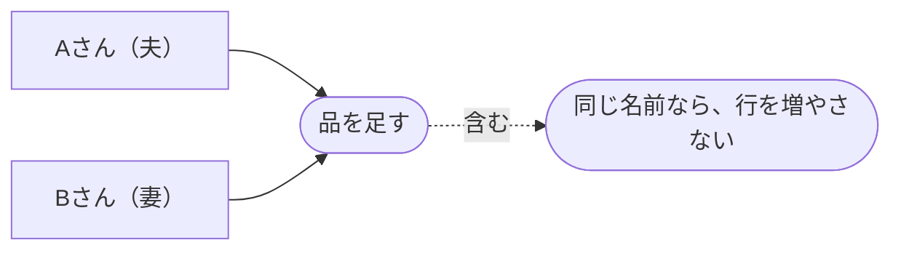
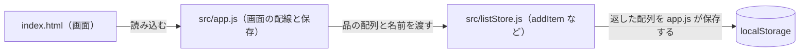
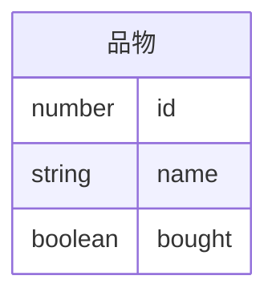

# 設計書：同じ品をまとめる

元の要件定義書：docs/requirements/同じ品をまとめる.md

## 1. 解決したい課題・概要

今は同じ名前の品を足すと、大文字・小文字や前後の空白が違うだけでも、まったく同じ名前でも、新しい行が増える。そのため同じ物を2回買ってしまう。
品を足すとき、すでにある品と同じ名前なら、行を増やさない。

## 2. 技術の前提

- 言語：素の HTML・CSS・JavaScript（ES モジュール）。フレームワークとビルド工程は足さない
- 保存先：ブラウザの `localStorage`（キー `family-shopping-list-items`、今までどおり）
- 動く環境：ブラウザ。GitHub Pages で公開
- テスト：`test/unit/` に node:test のユニットテスト。`npm test` と `npm run lint` を通す

## 3. 変えるところ

- `src/listStore.js` の `addItem`
  - 前後の空白を除いて小文字にした名前で、すでにある品と比べる。同じ品があれば、新しい行は足さず、受け取った配列と同じ中身を返す（FR-01、FR-02）
  - 同じ品がなければ、今までどおり末尾に新しい行を足す（FR-03）
  - 空白だけの入力は、今までどおり「品名を入力してください」で拒否する
  - 比べるための名前の直し方は、`src/listStore.js` の内部関数（例：`normalizeName`）に置く。`trim` と `toLowerCase` だけを使い、全角・半角やひらがな・カタカナの変換はしない
- `test/unit/listStore.test.js` に、`addItem` のテストを足す
- `toggleBought`、`deleteItem`、`filterItems`、`countToBuy` と `src/app.js` は変えない

## 4. データの形

変えない。品物＝`{ id: number, name: string, bought: boolean }`。

- `id`：「現在の最大 id + 1」のまま。行が増えないときは、新しい id を作らない
- `name`：前からある行の表記のまま（「milk」の行に「Milk」を足しても「milk」のまま）
- `bought`：行が増えないときは、前からある行の値のまま
- 保存の形（`localStorage` の JSON）は今までと同じなので、保存データの移行は要らない

## 図（ユースケース図・アーキテクチャ図・ERD）

### ユースケース図

### アーキテクチャ図

### ERD

## 5. エラーとイレギュラー

- 空白だけの入力：今までどおり「品名を入力してください」を出して拒否する。保存データは変わらない
- 間違えて足した品：今までどおり「削除」で消せる
- チェック済みの品と同じ名前を足したとき：行は増えず、チェックも付いたまま（チェックを外す動きは対象外）
- 前から2行になっている品：保存データには手を入れず、そのまま残す
- 全角と半角、ひらがなとカタカナの違いは、別の品のままにする（対象外）
- 行が増えないとき画面で知らせることは、作らない（対象外）

## 6. テスト観点

- AC-01：テスト名 `AC-01 addItem: 同じ名前の品を足しても、行は増えない`。「牛乳」の入った配列と `'牛乳'` を渡し、返る配列の長さが1のままであることを確かめる
- AC-02：テスト名 `AC-02 addItem: 大文字・小文字と前後の空白の違いは同じ品として扱う`。「milk」の入った配列に `'Milk'` と `' milk '` を渡し、どちらも長さが1のままで、名前が「milk」のままであることを確かめる
- AC-03：テスト名 `AC-03 addItem: 違う名前の品を足すと、行が増える`。「牛乳」の入った配列と `'卵'` を渡し、長さが2になり、2行目が「卵」であることを確かめる
- 既存の機能：既存のテストをすべて通し（`npm test`）、`npm run lint` を通す。空白だけの入力の拒否と、入力を書き換えない（イミュータブル）ことの既存テストも含めて確かめる

## 7. タスク（→ Issue）

- #1 `addItem` で同じ品をまとめる（AC-01〜03）。実装とユニットテスト（`test/unit/listStore.test.js`）を同じ Issue に入れる
