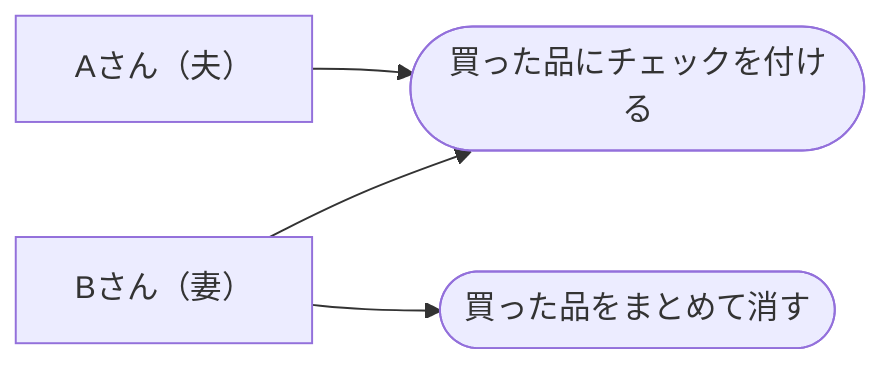
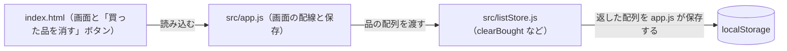
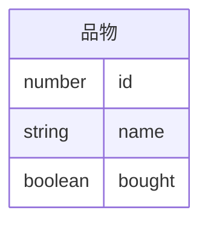

# 設計書：買った品をまとめて消す

元の要件定義書：docs/specs/買った品をまとめて消す/要件定義書.md

## 1. 解決したい課題・概要

今は行を消すには、行ごとの「削除」を押すしかない。チェックを付けた行が残り続け、まだ買っていない品が埋もれる。
「買った品を消す」ボタンを1つ置き、押すとチェックを付けた行をまとめて消す。

## 2. 技術の前提

- 言語：素の HTML・CSS・JavaScript（ES モジュール）。フレームワークとビルド工程は足さない
- 保存先：ブラウザの `localStorage`（キー `family-shopping-list-items`、今までどおり）
- 動く環境：ブラウザ。GitHub Pages で公開
- テスト：`test/unit/` に node:test のユニットテスト。`npm test` と `npm run lint` を通す

## 3. 変えるところ

- `src/listStore.js` に `clearBought(items)` を足す
  - `bought` が `true` の品を除いた新しい配列を返す（FR-01）
  - 残る品の順・名前・id・`bought` は変えない（FR-02）
  - チェック済みの品がなければ、同じ中身の配列を返す（FR-03）
  - 受け取った配列は書き換えない（イミュータブル）
- `index.html` のリストの下に、ボタン「買った品を消す」を足す（`data-testid="clear-bought-button"`）
- `src/app.js` で、ボタンを押したら `clearBought` を呼んで保存し、描き直す
- `test/unit/listStore.test.js` に、`clearBought` のテストを足す
- `addItem`、`toggleBought`、`deleteItem`、`filterItems`、`countToBuy` は変えない

## 4. データの形

変えない。品物＝`{ id: number, name: string, bought: boolean }`。

- 保存の形（`localStorage` の JSON）は今までと同じなので、保存データの移行は要らない

## 図（ユースケース図・アーキテクチャ図・ERD）

### ユースケース図

### アーキテクチャ図

### ERD

## 5. エラーとイレギュラー

- チェック済みの品が1つもないとき：押してもリストは変わらない。エラーは出さない
- 間違えて押したとき：元に戻す操作は作らない（対象外）。消した品は、足し直す
- 絞り込みで「まだ買っていない」を表示しているとき：画面に見えていなくても、チェック済みの行は消える

## 6. テスト観点

- AC-01：テスト名 `AC-01 clearBought: チェックを付けた行がまとめて消える`。「牛乳」「卵」「パン」のうち「卵」と「パン」の `bought` を `true` にした配列を渡し、返る配列が「牛乳」の1行だけであることを確かめる
- AC-02：テスト名 `AC-02 clearBought: まだ買っていない品は同じ順で残る`。「牛乳」「卵」「パン」「りんご」のうち「卵」だけ `bought` を `true` にした配列を渡し、返る配列の名前が「牛乳」「パン」「りんご」の順であることを確かめる
- AC-03：テスト名 `AC-03 clearBought: チェックが1つもなければ変わらない`。チェックのない「牛乳」「卵」を渡し、返る配列が同じ中身であることを確かめる
- 既存の機能：既存のテストをすべて通し（`npm test`）、`npm run lint` を通す。受け取った配列を書き換えない（イミュータブル）ことも確かめる

## 7. タスク（→ Issue）

- #1 「買った品を消す」ボタンでチェック済みの行をまとめて消す（AC-01〜03）。`clearBought`、ボタンと配線、ユニットテスト（`test/unit/listStore.test.js`）を同じ Issue に入れる
